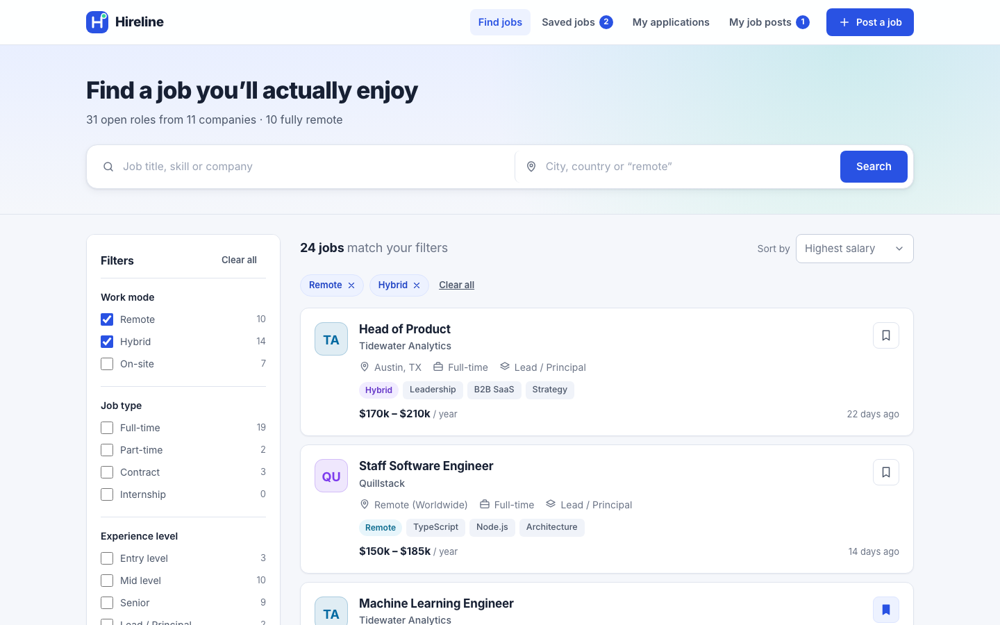
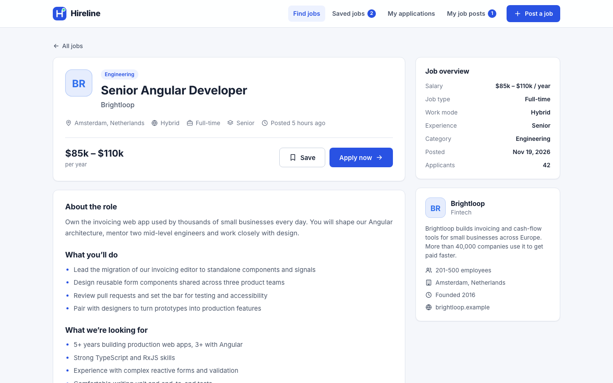
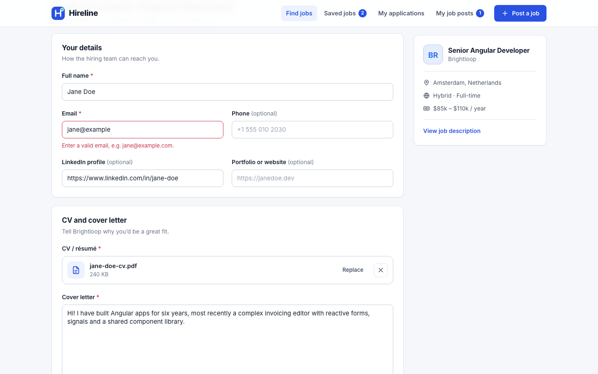
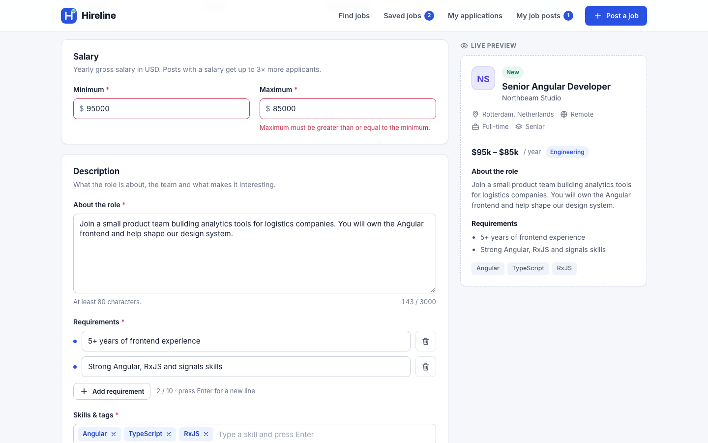

# Job Board

A job board built with Angular 21: search and filter jobs, apply with your CV, save jobs and post your own openings.

**Live demo:** https://hkhodkar.github.io/job-board/



| Job detail | Apply form |
| --- | --- |
|  |  |



## Features

- **Job list** with 30 sample jobs from 10 fictional companies (logos are generated SVG initials, no external images)
- **Filters** for keyword, location, work mode (remote / hybrid / on-site), job type, experience level, salary range, category and posting date, with live result counts per option
- **Filters live in the URL** (`/jobs?q=angular&mode=remote&minSalary=80&sort=salary-desc`), so searches can be bookmarked, shared and survive a reload
- **Sorting** by newest or salary, active filter chips and a "Show more" button
- **Job detail** page with description sections, salary, tags, company card and similar jobs
- **Apply form** (typed reactive form): name, email, optional phone, LinkedIn and portfolio URL validation, cover letter with character counter and a CV upload with drag & drop
  - accepts PDF, DOC and DOCX up to 5 MB, with clear messages for wrong types, empty and too-large files
  - shows the chosen file name and size with replace / remove actions
  - success screen, and every application is tracked under **My applications**
- **Post a job** form in sections with a live preview: work mode, type, level, category, salary min/max with a cross-field validator, description counter, requirements as a dynamic `FormArray` and a chips input for tags
- **My job posts**: posted jobs are stored in `localStorage`, appear at the top of the job list with a "New" badge, and can be edited or deleted
- **Saved jobs**: bookmark any job and find it on the Saved jobs page
- Responsive layout down to 375px, keyboard friendly dialogs and visible focus states

## Tech Stack

- Angular 21 (standalone components, zoneless change detection, signals and `computed`, new control flow, `OnPush`)
- Typed reactive forms with custom validators and `ControlValueAccessor` components (file drop, tag input)
- Lazy-loaded routes with component input binding
- Custom SCSS design system (no UI library)
- Vitest unit tests
- GitHub Actions + GitHub Pages for the live demo

## Getting Started

Requirements: Node.js 20.19+ (22 recommended) and npm.

```bash
git clone https://github.com/hkhodkar/job-board.git
cd job-board
npm install
npm start          # http://localhost:4307
```

Other scripts:

```bash
npm test -- --watch=false   # unit tests
npm run build               # production build in dist/job-board
```

There is no backend: jobs come from a local data file, and saved jobs, applications and posted jobs are kept in your browser's `localStorage`.

## Project Structure

```
src/app/
├── core/
│   ├── data/          # fictional companies and jobs
│   ├── models/        # Job, Company, Application, filter options
│   ├── services/      # JobsService (seed + posted jobs, similar jobs)
│   ├── stores/        # saved jobs, posted jobs and applications (signals + localStorage)
│   └── utils/         # filtering, sorting, URL params, storage helpers
├── features/
│   ├── jobs/          # job list with filters, job detail
│   ├── apply/         # apply form and success state
│   ├── applications/  # My applications
│   ├── employer/      # post / edit a job, My job posts
│   └── saved/         # saved jobs
└── shared/
    ├── components/    # job card, company logo, file drop, tag input, dialog, toasts
    ├── pipes/         # salary, time ago, file size, option labels
    └── validators/    # salary range, file type/size, URL and LinkedIn validators
```

## Author

Hatef Khodkar – [github.com/hkhodkar](https://github.com/hkhodkar)

## License

[MIT](LICENSE)
